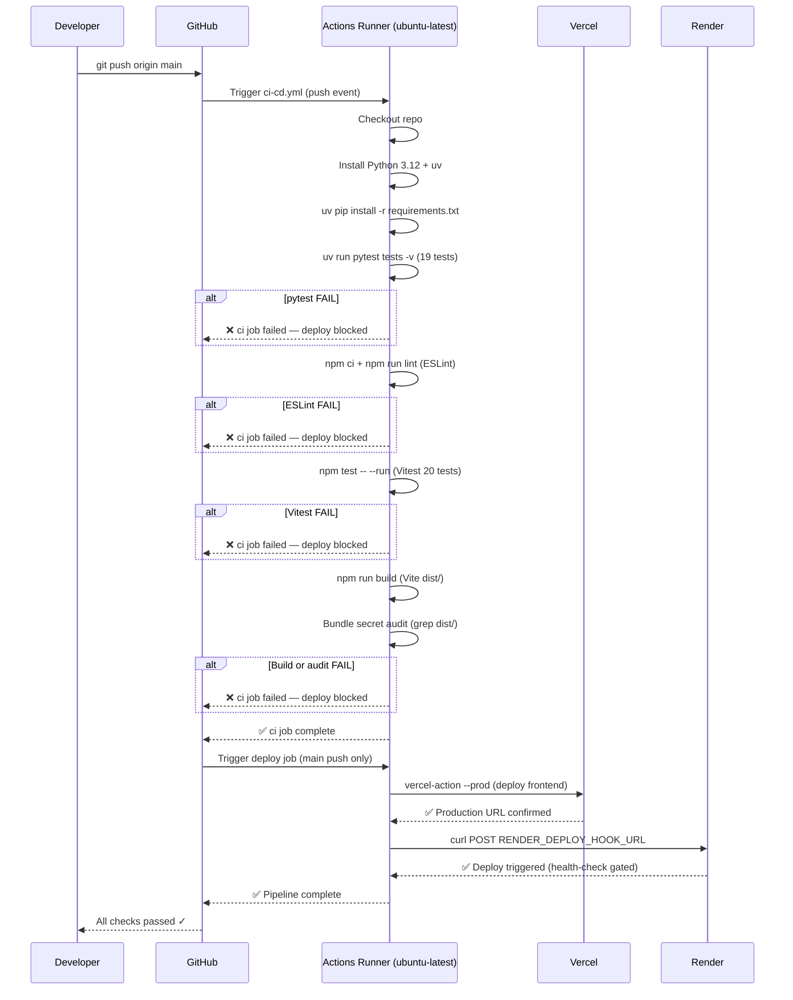

# implementation.md
## FEAT-M2-CICD — Automated CI/CD & Production Deployment

- **Feature ID**: `FEAT-M2-CICD`
- **Milestone**: Milestone 2, Workstream 3
- **Date**: 2026-11-03

---

## Architectural Overview

```
GitHub Repository (main branch)
        │
        ▼
.github/workflows/ci-cd.yml
        │
        ├── [Job 1: ci] ─────────────────────────────────────────────
        │     Runs on: ubuntu-latest
        │     Triggers: push to main, pull_request targeting main
        │     Steps:
        │       1. actions/checkout@v4
        │       2. Set up Python 3.12
        │       3. Install uv + backend deps (uv pip install -r requirements.txt)
        │       4. uv run pytest tests -v           → 19 tests must pass
        │       5. Set up Node 20 + npm ci
        │       6. npm run lint                     → ESLint, 0 errors
        │       7. npm test -- --run                → Vitest, 20 tests
        │       8. npm run build                    → Vite dist/ artifact
        │
        └── [Job 2: deploy] ─────────────────────────────────────────
              Runs on: ubuntu-latest
              Needs: ci (job 1 must pass)
              Condition: push to main only (PRs skipped)
              Steps:
                1. actions/checkout@v4
                2. amondnet/vercel-action@v25       → Deploy frontend dist/
                3. curl POST RENDER_DEPLOY_HOOK_URL → Trigger backend re-deploy
```

---

## Files to Create

| File | Location | Purpose |
|------|----------|---------|
| `ci-cd.yml` | `.github/workflows/ci-cd.yml` | Full CI + CD pipeline |
| `Dockerfile` | `backend/Dockerfile` | Render container image |
| `render.yaml` | `render.yaml` (repo root) | Render IaC service declaration |

---

## File 1: `.github/workflows/ci-cd.yml`

```yaml
name: CI & CD

on:
  push:
    branches: [main]
  pull_request:
    branches: [main]

jobs:
  ci:
    name: Lint · Test · Build
    runs-on: ubuntu-latest

    steps:
      - name: Checkout repository
        uses: actions/checkout@v4

      # ── Backend ──────────────────────────────────────────────────
      - name: Set up Python 3.12
        uses: actions/setup-python@v5
        with:
          python-version: "3.12"

      - name: Install uv
        run: curl -LsSf https://astral.sh/uv/install.sh | sh

      - name: Install backend dependencies
        run: |
          cd backend
          uv venv
          uv pip install -r requirements.txt

      - name: Run backend tests
        run: |
          cd backend
          uv run pytest tests -v
        env:
          RESEND_API_KEY: ${{ secrets.RESEND_API_KEY }}
          GITHUB_USERNAME: ${{ secrets.GITHUB_USERNAME }}
          CACHE_TTL: ${{ secrets.CACHE_TTL }}

      # ── Frontend ─────────────────────────────────────────────────
      - name: Set up Node 20
        uses: actions/setup-node@v4
        with:
          node-version: "20"
          cache: "npm"
          cache-dependency-path: frontend/package-lock.json

      - name: Install frontend dependencies
        run: |
          cd frontend
          npm ci

      - name: Lint frontend (ESLint)
        run: |
          cd frontend
          npm run lint

      - name: Run frontend tests (Vitest)
        run: |
          cd frontend
          npm test -- --run

      - name: Build frontend (production)
        run: |
          cd frontend
          npm run build

      - name: Audit bundle for leaked secrets
        run: |
          if grep -r "RESEND_API_KEY" frontend/dist/ 2>/dev/null; then
            echo "SECRET LEAK DETECTED in frontend bundle!" && exit 1
          fi
          echo "Bundle secret audit: CLEAN"

  deploy:
    name: Deploy to Production
    needs: ci
    runs-on: ubuntu-latest
    if: github.ref == 'refs/heads/main' && github.event_name == 'push'

    steps:
      - name: Checkout repository
        uses: actions/checkout@v4

      - name: Deploy frontend to Vercel (production)
        uses: amondnet/vercel-action@v25
        with:
          vercel-token: ${{ secrets.VERCEL_TOKEN }}
          vercel-org-id: ${{ secrets.VERCEL_ORG_ID }}
          vercel-project-id: ${{ secrets.VERCEL_PROJECT_ID }}
          working-directory: ./frontend
          vercel-args: "--prod"

      - name: Trigger Render backend re-deploy
        run: |
          curl -fsSX POST "${{ secrets.RENDER_DEPLOY_HOOK_URL }}"
          echo "Render deploy hook triggered successfully."
```

---

## File 2: `backend/Dockerfile`

```dockerfile
FROM python:3.12-slim

WORKDIR /app

# Install uv for fast dependency resolution
RUN pip install uv

# Copy and install dependencies first (layer caching)
COPY requirements.txt .
RUN uv pip install --system -r requirements.txt

# Copy application source
COPY . .

# Expose FastAPI port
EXPOSE 8000

# Start Uvicorn server
CMD ["uvicorn", "app.main:app", "--host", "0.0.0.0", "--port", "8000"]
```

---

## File 3: `render.yaml`

```yaml
services:
  - type: web
    name: personal-portfolio-backend
    runtime: docker
    dockerfilePath: ./backend/Dockerfile
    dockerContext: ./backend
    plan: free
    healthCheckPath: /api/health
    envVars:
      - key: RESEND_API_KEY
        sync: false          # Injected via Render Dashboard → Environment
      - key: GITHUB_USERNAME
        value: myrson2
      - key: CACHE_TTL
        value: "900"         # 15 minutes TTL for GitHub API caching
```

---

## GitHub Secrets Reference Table

| Secret Name | Where to Get It | Description |
|-------------|-----------------|-------------|
| `GITHUB_TOKEN` | Auto-provided by GitHub Actions | Used internally by Vercel action |
| `VERCEL_TOKEN` | Vercel Dashboard → Settings → Tokens | Auth token for Vercel CLI deploys |
| `VERCEL_ORG_ID` | Vercel Project → Settings → General | Vercel organization identifier |
| `VERCEL_PROJECT_ID` | Vercel Project → Settings → General | Vercel project identifier |
| `RENDER_DEPLOY_HOOK_URL` | Render Dashboard → Service → Deploy Hooks | Webhook URL to trigger re-deploy |
| `RESEND_API_KEY` | Resend Dashboard → API Keys | Transactional email API key |
| `GITHUB_USERNAME` | Static value: `myrson2` | GitHub username for API proxy |
| `CACHE_TTL` | Static value: `900` | Cache TTL in seconds (15 min) |

---

## Control Flow Sequence Diagram



---

## Failure Handling

| Failure Mode | Behavior |
|-------------|----------|
| pytest test failure | `ci` job exits non-zero → `deploy` job skipped |
| ESLint error | `ci` job exits non-zero → `deploy` job skipped |
| Vitest test failure | `ci` job exits non-zero → `deploy` job skipped |
| Vite build error | `ci` job exits non-zero → `deploy` job skipped |
| Secret leak detected in bundle | Custom audit step exits 1 → `deploy` job skipped |
| Vercel deploy failure | `deploy` job exits non-zero → Render hook not called |
| Render hook failure | `curl -fsSX` fails verbosely → reported in Actions log |
| Render health-check fail | Render does not route traffic until `/api/health` returns 200 |

