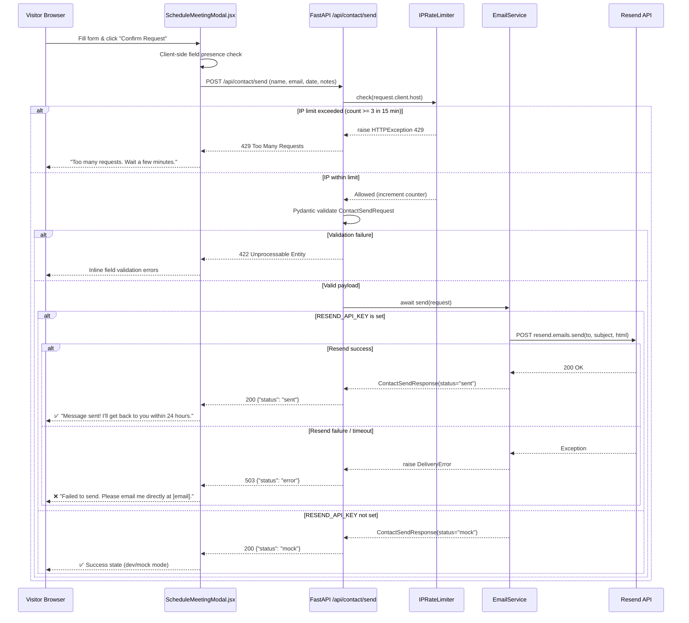

# Implementation: Live Contact Gateway
- **Feature ID**: `FEAT-M2-LIVE-CONTACT-GATEWAY`
- **Milestone**: Milestone 2
- **Status**: Approved — Pending Implementation

---

## 1. Architectural Overview

```
[Browser: ScheduleMeetingModal.jsx]
    │  POST /api/contact/send  (JSON)
    ▼
[Vite Dev Proxy → localhost:8001]  (production: direct HTTPS to backend host)
    │
    ▼
[FastAPI: contact.py endpoint]
    ├── 1. IP Rate Limit Check  (TTLCache — 3 req / 15 min / IP)
    ├── 2. Pydantic model validation (ContactSendRequest)
    ├── 3. EmailService.send(request)
    │       ├── If RESEND_API_KEY set  → Resend SDK async call
    │       └── If not set            → Log warning, return mock response
    └── 4. Return structured JSON (200 / 422 / 429 / 503)
```

**Component boundary**: The frontend is strictly a consumer — it never holds credentials or constructs email payloads directly. All delivery logic is encapsulated in `EmailService`.

---

## 2. New & Modified Files

### Backend

| File | Action | Description |
|------|--------|-------------|
| `backend/app/models/contact.py` | **Modify** | Add `ContactSendRequest` and `ContactSendResponse` Pydantic models |
| `backend/app/services/email_service.py` | **New** | `EmailService` class with async `send(request)` method via Resend SDK |
| `backend/app/api/endpoints/contact.py` | **Modify** | Replace placeholder handler with `/send` route + `IPRateLimiter` dependency |
| `backend/app/core/config.py` | **Modify** | Add `RESEND_API_KEY: str = ""` and `RESEND_TO_EMAIL: str = ""` to settings |
| `backend/app/core/rate_limiter.py` | **New** | `IPRateLimiter` using `TTLCache(maxsize=1000, ttl=900)` |
| `backend/requirements.txt` | **Modify** | Add `resend` package |
| `backend/.env.example` | **Modify** | Document `RESEND_API_KEY` and `RESEND_TO_EMAIL` |
| `backend/tests/test_contact.py` | **Modify** | Update to cover `/send` endpoint; add rate limit + Resend mock tests |

### Frontend

| File | Action | Description |
|------|--------|-------------|
| `frontend/src/services/api.js` | **Modify** | Add `sendContact(payload)` fetch wrapper → `POST /api/contact/send` |
| `frontend/src/components/Modals/ScheduleMeetingModal.jsx` | **Modify** | Wire submit to `sendContact()`, handle `loading` / `success` / `error` / `rateLimit` UI states |

---

## 3. Data Models

### `ContactSendRequest`
```python
from pydantic import BaseModel, Field
from typing import Optional
import re

EMAIL_REGEX = re.compile(r"^[\w\.-]+@[\w\.-]+\.\w+$")

class ContactSendRequest(BaseModel):
    name: str = Field(..., min_length=1, max_length=100)
    email: str = Field(..., pattern=r"^[\w\.-]+@[\w\.-]+\.\w+$")
    preferred_date: Optional[str] = Field(None, max_length=50)
    notes: Optional[str] = Field(None, max_length=2000)
```

### `ContactSendResponse`
```python
from typing import Literal

class ContactSendResponse(BaseModel):
    status: Literal["sent", "mock", "error"]
    message: str
```

---

## 4. API Contract

### `POST /api/contact/send`

**Request Headers:**
```
Content-Type: application/json
Origin: http://localhost:5173  (dev) | https://your-portfolio.vercel.app (prod)
```

**Request Body:**
```json
{
  "name": "John Doe",
  "email": "john@company.com",
  "preferred_date": "2026-11-10",
  "notes": "Would love to discuss a full-stack project"
}
```

**Responses:**

| Status | Body | Condition |
|--------|------|-----------|
| `200 OK` | `{"status": "sent", "message": "Email delivered successfully"}` | Resend call succeeded |
| `200 OK` | `{"status": "mock", "message": "Email delivery skipped (no API key configured)"}` | `RESEND_API_KEY` not set |
| `422 Unprocessable Entity` | `{"detail": [...Pydantic errors...]}` | Invalid or missing fields |
| `429 Too Many Requests` | `{"detail": "Too many requests. Please wait before submitting again."}` | IP rate limit exceeded |
| `503 Service Unavailable` | `{"status": "error", "message": "Delivery failed. Please try again."}` | Resend SDK threw exception |

---

## 5. Email Template

```html
Subject: Portfolio Contact: Meeting Request from {name}

<html>
<body style="font-family: monospace; color: #111827; background: #fff; padding: 24px;">
  <h2 style="border-bottom: 2px solid #111827; padding-bottom: 8px;">
    📬 New Portfolio Contact
  </h2>
  <table>
    <tr><td><strong>From:</strong></td><td>{name}</td></tr>
    <tr><td><strong>Email:</strong></td><td>{email}</td></tr>
    <tr><td><strong>Preferred Date:</strong></td><td>{preferred_date or "Not specified"}</td></tr>
  </table>
  <p><strong>Message / Notes:</strong></p>
  <blockquote style="border-left: 3px solid #7bb2ff; padding-left: 12px; color: #374151;">
    {notes or "No message provided."}
  </blockquote>
  <hr/>
  <small style="color: #9ca3af;">Sent via Personal Portfolio Contact Gateway</small>
</body>
</html>
```

---

## 6. Control Flow Sequence Diagram



---

## 7. Implementation Details

### `backend/app/core/rate_limiter.py`
```python
from cachetools import TTLCache
from fastapi import Request, HTTPException

# 15-minute window, max 1000 tracked IPs in memory
_rate_cache: TTLCache = TTLCache(maxsize=1000, ttl=900)

class IPRateLimiter:
    def __init__(self, max_calls: int = 3):
        self.max_calls = max_calls

    def check(self, request: Request) -> None:
        ip = request.client.host
        count = _rate_cache.get(ip, 0)
        if count >= self.max_calls:
            raise HTTPException(
                status_code=429,
                detail="Too many requests. Please wait before submitting again."
            )
        _rate_cache[ip] = count + 1
```

### `backend/app/services/email_service.py`
```python
import logging
from app.core.config import settings
from app.models.contact import ContactSendRequest, ContactSendResponse

logger = logging.getLogger(__name__)

class EmailService:
    async def send(self, request: ContactSendRequest) -> ContactSendResponse:
        if not settings.RESEND_API_KEY:
            logger.warning("RESEND_API_KEY not set — skipping email delivery (mock mode).")
            return ContactSendResponse(
                status="mock",
                message="Email delivery skipped (no API key configured)"
            )
        try:
            import resend
            resend.api_key = settings.RESEND_API_KEY
            html_body = f"""
            <html><body style="font-family: monospace; color: #111827; padding: 24px;">
            <h2>📬 New Portfolio Contact</h2>
            <p><strong>From:</strong> {request.name} ({request.email})</p>
            <p><strong>Preferred Date:</strong> {request.preferred_date or 'Not specified'}</p>
            <p><strong>Notes:</strong></p>
            <blockquote style="border-left:3px solid #7bb2ff; padding-left:12px;">
              {request.notes or 'No message provided.'}
            </blockquote>
            <hr/><small>Sent via Personal Portfolio Contact Gateway</small>
            </body></html>
            """
            resend.Emails.send({
                "from": f"Portfolio <onboarding@resend.dev>",
                "to": [settings.RESEND_TO_EMAIL],
                "subject": f"Portfolio Contact: Meeting Request from {request.name}",
                "html": html_body,
            })
            return ContactSendResponse(status="sent", message="Email delivered successfully")
        except Exception as e:
            logger.error(f"Resend delivery failed: {e}")
            from fastapi import HTTPException
            raise HTTPException(status_code=503, detail=None)

email_service = EmailService()
```

### `backend/app/api/endpoints/contact.py` (updated route)
```python
from fastapi import APIRouter, Request, HTTPException
from app.models.contact import ContactSendRequest, ContactSendResponse
from app.services.email_service import email_service
from app.core.rate_limiter import IPRateLimiter

router = APIRouter()
rate_limiter = IPRateLimiter(max_calls=3)

@router.post("/send", response_model=ContactSendResponse)
async def send_contact(payload: ContactSendRequest, request: Request):
    rate_limiter.check(request)
    try:
        return await email_service.send(payload)
    except HTTPException:
        raise
    except Exception as e:
        raise HTTPException(status_code=503, detail="Delivery failed. Please try again.")
```

### `frontend/src/services/api.js` (addition)
```javascript
export async function sendContact(payload) {
  try {
    const res = await fetch('/api/contact/send', {
      method: 'POST',
      headers: { 'Content-Type': 'application/json' },
      body: JSON.stringify(payload),
    });
    if (res.status === 429) return { status: 'rateLimit' };
    if (!res.ok) return { status: 'error' };
    return await res.json();  // { status: "sent" | "mock" }
  } catch {
    return { status: 'error' };
  }
}
```

### Frontend Modal State Machine (`ScheduleMeetingModal.jsx`)
```
States: idle → loading → success | error | rateLimit

idle:      Form visible, "Confirm Request" button active
loading:   Button shows spinner, inputs disabled
success:   Form replaced with: "✅ Message sent! I'll get back to you within 24 hours."
error:     Form replaced with: "❌ Failed to send. Please email me directly at [email]."
rateLimit: Form replaced with: "⏳ Too many requests. Please wait a few minutes."
```

---

## 8. Environment Variables

### `backend/.env` (additions)
```env
# Resend Email Delivery
RESEND_API_KEY=re_xxxxxxxxxxxxxxxxxxxx
RESEND_TO_EMAIL=your@email.com
```

### `backend/.env.example` (additions)
```env
# Resend transactional email (https://resend.com)
RESEND_API_KEY=             # Your Resend API key — never commit this
RESEND_TO_EMAIL=            # Recipient email for contact form submissions
```

---

## 9. Failure Handling & Exception Mappings

| Failure Scenario | Backend Response | Frontend Reaction |
|---|---|---|
| Resend SDK exception (any) | HTTP 503 + `{"status": "error"}` | Error state + direct email fallback |
| `RESEND_API_KEY` not set | HTTP 200 + `{"status": "mock"}` | Success state (dev transparency) |
| Pydantic validation fail | HTTP 422 + detail array | Inline field errors |
| IP rate limit exceeded | HTTP 429 + detail string | Rate limit message |
| Network timeout (frontend fetch) | `catch` → `{status: "error"}` | Error state + direct email fallback |
