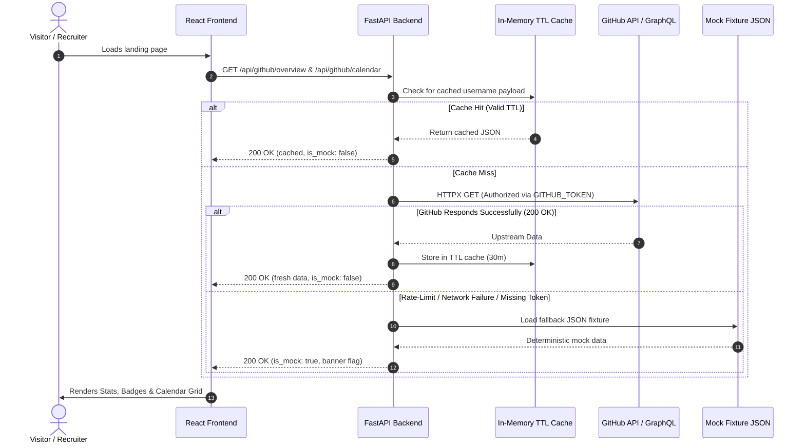

# Implementation Architecture: Milestone 1 Core Showcase

- **Feature ID**: `FEAT-M1-CORE-SHOWCASE`
- **Target Milestone**: Milestone 1
- **Status**: Approved & Ready for Implementation

---

### 1. Monorepo Architecture & Directory Boundaries

```
Personal-Portfolio/
├── frontend/                     # React 18+ with Vite & Bootstrap 5.3
│   ├── src/
│   │   ├── assets/               # Local avatar, certificate placeholders
│   │   ├── components/
│   │   │   ├── Header/           # ProfileHeader, Banner, MetadataBadges, CTAButtonGroup
│   │   │   ├── About/            # AboutSection, SocialLinks, StatBar
│   │   │   ├── Projects/         # ProjectsSection, FeaturedCard, ProjectRowItem
│   │   │   ├── Certifications/   # CertificationsCarousel (RTL autoplay), CertCard
│   │   │   ├── Calendar/         # GitHubCalendarGrid
│   │   │   └── Modals/           # MeetingModal, DownloadCVModal, CommunityModal
│   │   ├── styles/
│   │   │   ├── retro-pixel.css   # Pixel borders, tactile button offsets, retro badges
│   │   │   └── layout.css        # Two-column asymmetrical editorial grid
│   │   ├── services/             # API client functions (HTTP calls to FastAPI proxy)
│   │   ├── __tests__/            # Frontend Component Test Suite (Vitest + RTL)
│   │   │   ├── ProfileHeader.test.jsx
│   │   │   ├── ScheduleMeetingModal.test.jsx
│   │   │   ├── AboutSection.test.jsx
│   │   │   ├── ProjectsSection.test.jsx
│   │   │   ├── CertificationsCarousel.test.jsx
│   │   │   └── GitHubCalendarGrid.test.jsx
│   │   ├── App.jsx
│   │   └── main.jsx
│   ├── package.json              # Includes vitest, @testing-library/react, jsdom
│   └── vite.config.js
└── backend/                      # FastAPI Python Application
    ├── app/
    │   ├── api/
    │   │   ├── endpoints/
    │   │   │   ├── health.py     # GET /api/health
    │   │   │   ├── github.py     # GET /api/github/overview, GET /api/github/calendar
    │   │   │   └── contact.py    # POST /api/contact/placeholder
    │   │   └── router.py         # Consolidated API router
    │   ├── core/
    │   │   ├── config.py         # Pydantic Settings (GITHUB_USERNAME, GITHUB_TOKEN, CORS)
    │   │   └── cache.py          # In-memory TTL Cache setup (cachetools)
    │   ├── fixtures/             # Deterministic fallback JSON files
    │   │   ├── github_overview_fallback.json
    │   │   └── github_calendar_fallback.json
    │   ├── models/               # Pydantic schemas for requests and responses
    │   │   ├── github.py
    │   │   └── contact.py
    │   ├── services/
    │   │   └── github_service.py # HTTPX client with caching & fallback logic
    │   └── main.py
    ├── tests/                    # Backend Test Suite (pytest + httpx TestClient)
    │   ├── test_health.py
    │   ├── test_github_overview.py
    │   ├── test_github_calendar.py
    │   ├── test_contact.py
    │   └── test_cors.py
    ├── requirements.txt          # Includes pytest, pytest-asyncio, httpx
    └── .env.example
```

---

### 2. Data Models & API Contracts

#### A. `GET /api/github/overview`
- **Query Params**: `username: str = "myrson2"`
- **Response Schema** (`200 OK`):
```json
{
  "username": "myrson2",
  "total_repos": 40,
  "total_commits": 5000,
  "followers": 15,
  "avatar_url": "https://avatars.githubusercontent.com/u/...",
  "status": "Online",
  "is_mock": false,
  "cached_at": "2026-11-03T12:00:00Z"
}
```

#### B. `GET /api/github/calendar`
- **Query Params**: `username: str = "myrson2"`
- **Response Schema** (`200 OK`):
```json
{
  "username": "myrson2",
  "total_contributions": 1420,
  "weeks": [
    {
      "days": [
        { "date": "2026-01-01", "count": 4, "level": 2 }
      ]
    }
  ],
  "is_mock": false,
  "cached_at": "2026-11-03T12:00:00Z"
}
```

#### C. `POST /api/contact/placeholder`
- **Request Payload**:
```json
{
  "name": "Jane Doe",
  "email": "jane@example.com",
  "preferred_date": "2026-11-10",
  "notes": "Discussing AI systems collaboration",
  "type": "meeting"
}
```
- **Response Schema** (`201 Created`):
```json
{
  "status": "success",
  "message": "Meeting request placeholder recorded. Real email delivery activates in Milestone 2.",
  "received_at": "2026-11-03T13:15:00Z"
}
```

---

### 3. Control Flow Architecture



---

### 4. Component Details & CSS Techniques

#### A. Certifications RTL Autoplay Carousel
- **CSS Animation**: Continuous translation (`@keyframes scrollRTL { 0% { transform: translateX(0); } 100% { transform: translateX(-50%); } }`) with duplicated item set for seamless loop.
- **Interaction**:
  - `animation-play-state: paused;` on `:hover`.
  - Manual Previous / Next stepped pixel buttons that temporarily pause the loop and shift the carousel by card width.

#### B. Subtle Retro Pixel Styling (`retro-pixel.css`)
- **Pixel Borders**: Stepped retro box-shadow borders:
  ```css
  box-shadow: 2px 2px 0 #000, -2px -2px 0 #000, 2px -2px 0 #000, -2px 2px 0 #000;
  ```
- **Tactile Button Press**:
  ```css
  .btn-retro {
    background: #000;
    color: #fff;
    box-shadow: 3px 3px 0 #000;
    transition: transform 0.05s ease, box-shadow 0.05s ease;
  }
  .btn-retro:active {
    transform: translate(2px, 2px);
    box-shadow: 1px 1px 0 #000;
  }
  ```
- **Monospace Stat Counters**:
  ```css
  .stat-number {
    font-family: 'Courier New', Courier, monospace;
    font-weight: 700;
    font-size: 2rem;
  }
  ```

---

### 5. Exception Handling & Error Boundaries
- **Network Outage**: React shows cached/fallback data with a subtle toast: *"Viewing offline portfolio snapshot"*.
- **Validation Errors on Form**: FastAPI returns `422 Unprocessable Entity` with clean Pydantic field-level errors; React highlights invalid inputs in red.
