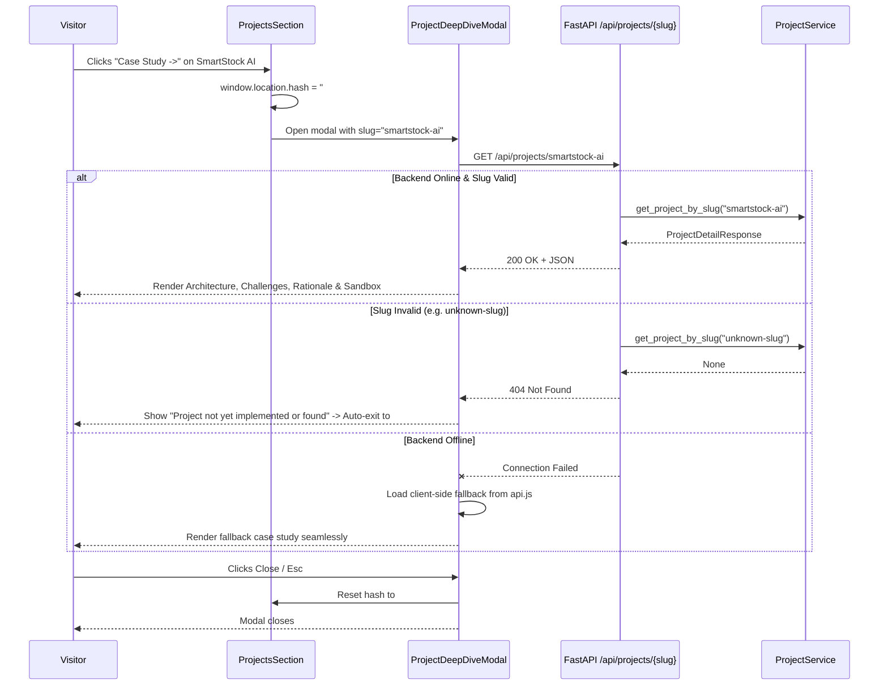

# Implementation: Dedicated Project Details Modal / Deep Dive Routes
- **Feature ID**: `FEAT-M2-PROJECT-DEEP-DIVE`
- **Milestone**: Milestone 2 (`specs/roadmap.md`)
- **Status**: Approved — Pending Implementation

---

## 1. Architectural Overview

```
[Browser: User / Recruiter]
       │
       ├── Clicks "Case Study" or visits #project/smartstock-ai
       ▼
[Frontend: ProjectsSection.jsx & ProjectDeepDiveModal.jsx]
       │
       ├── Reads URL hash & calls fetchProjectDetails(slug) in api.js
       │     ├── Online  → GET /api/projects/{slug}
       │     └── Offline → Client-side fallback JSON fixtures
       ▼
[FastAPI Backend: /api/projects & /api/projects/{slug}]
       │
       ├── ProjectService: Reads validated models from in-memory fixture store
       └── Returns ProjectDetailResponse (200) or 404
```

---

## 2. New & Modified Files

### Backend

| File | Action | Description |
|------|--------|-------------|
| `backend/app/models/project.py` | **New** | Pydantic models for project summary, metric, challenge/solution, and deep dive case study |
| `backend/app/fixtures/projects_data.json` | **New** | Rich case study datasets for `smartstock-ai` and `depths-descents` |
| `backend/app/services/project_service.py` | **New** | Service loading fixtures, indexing by slug, and returning validated schemas |
| `backend/app/api/endpoints/projects.py` | **New** | `GET /api/projects` and `GET /api/projects/{slug}` endpoints |
| `backend/app/api/router.py` | **Modify** | Register `projects.router` under `/api` |
| `backend/tests/test_projects.py` | **New** | Automated tests for list, get by slug, 404 not found, and schema integrity |

### Frontend

| File | Action | Description |
|------|--------|-------------|
| `frontend/src/services/api.js` | **Modify** | Add `fetchProjectDetails(slug)` with client-side fallback safety |
| `frontend/src/components/Modals/ProjectDeepDiveModal.jsx` | **New** | Modal component with tabbed sections (Overview, Architecture, Challenges, Rationale, Interactive Sandbox) |
| `frontend/src/components/Projects/ProjectsSection.jsx` | **Modify** | Add "Case Study ->" trigger button to featured cards and hook up hash listener |
| `frontend/src/styles/retro-pixel.css` | **Modify** | Add styles for project deep dive tabs, architectural flow boxes, and retro terminal widget |
| `frontend/src/__tests__/ProjectDeepDiveModal.test.jsx` | **New** | Vitest tests for deep dive modal render, tab switching, invalid slug handling, and close actions |

---

## 3. Data Models & Schemas

```python
# backend/app/models/project.py
from pydantic import BaseModel, Field
from typing import List, Optional

class ProjectMetric(BaseModel):
    label: str
    value: str
    description: str

class ChallengeSolution(BaseModel):
    challenge: str
    solution: str
    impact: str

class TechRationale(BaseModel):
    technology: str
    role: str
    rationale: str

class ArchitectureComponent(BaseModel):
    name: str
    description: str
    tech: str

class SimulatedDemoStep(BaseModel):
    command: str
    output: str

class ProjectSummaryResponse(BaseModel):
    slug: str
    title: str
    tagline: str
    category: str
    tags: List[str]
    github_url: str
    demo_url: Optional[str] = None

class ProjectDetailResponse(ProjectSummaryResponse):
    architecture_overview: str
    components: List[ArchitectureComponent]
    challenges: List[ChallengeSolution]
    tech_rationale: List[TechRationale]
    metrics: List[ProjectMetric]
    demo_instructions: str
    simulated_steps: List[SimulatedDemoStep]
```

---

## 4. API Contract

### `GET /api/projects`
**Response (200 OK):**
```json
[
  {
    "slug": "smartstock-ai",
    "title": "SmartStock AI",
    "tagline": "Autonomous inventory optimization system forecasting supply volatility.",
    "category": "AI & Systems Engineering",
    "tags": ["Python", "FastAPI", "React", "Gemini AI"],
    "github_url": "https://github.com/myrson2",
    "demo_url": null
  },
  {
    "slug": "depths-descents",
    "title": "Depths Descents: Game Engine",
    "tagline": "High-performance game experience with custom procedural generation and netcode.",
    "category": "Game Engine & Systems",
    "tags": ["Lua", "Roblox Studio", "Physics Engine"],
    "github_url": "https://github.com/myrson2",
    "demo_url": null
  }
]
```

### `GET /api/projects/{slug}`
**Response (200 OK):**
```json
{
  "slug": "smartstock-ai",
  "title": "SmartStock AI",
  "tagline": "Autonomous inventory optimization system forecasting supply volatility.",
  "category": "AI & Systems Engineering",
  "tags": ["Python", "FastAPI", "React", "Gemini AI"],
  "github_url": "https://github.com/myrson2",
  "demo_url": null,
  "architecture_overview": "Distributed microservice architecture with ingestion streams, vector indexing, and prediction pipelines.",
  "components": [
    {
      "name": "Predictive Forecast Engine",
      "description": "Analyzes historical order trends and seasonal shocks using LLM embeddings.",
      "tech": "FastAPI + Gemini AI"
    }
  ],
  "challenges": [
    {
      "challenge": "Model inference latency on high-frequency warehouse scans.",
      "solution": "Implemented in-memory LRU caching layer and batch vector calculations.",
      "impact": "Decreased p99 response time from 1.2s to 45ms."
    }
  ],
  "tech_rationale": [
    {
      "technology": "FastAPI",
      "role": "API Gateway & Inference Coordinator",
      "rationale": "High-throughput asynchronous ASGI throughput with native Pydantic schema validation."
    }
  ],
  "metrics": [
    {
      "label": "Stockout Reduction",
      "value": "-40%",
      "description": "Fewer critical out-of-stock incidents across test warehouse simulations."
    }
  ],
  "demo_instructions": "Run inventory simulation query against Gemini forecast model.",
  "simulated_steps": [
    {
      "command": "python cli.py predict --sku SKU-4029 --horizon 14d",
      "output": "[INFO] Forecasting demand for SKU-4029...\n[RESULT] Predicted demand: 420 units (Confidence: 94.2%)\n[ACTION] Auto-reorder triggered."
    }
  ]
}
```

**Response (404 Not Found):**
```json
{
  "detail": "Project not found"
}
```

---

## 5. Control Flow Sequence Diagram



---

## 6. Frontend Modal Architecture (`ProjectDeepDiveModal.jsx`)

The modal incorporates 5 tabs styled with retro-pixel design tokens:
1. **Overview & Metrics**: Key impact metrics grid (e.g. `-40%`, `60 FPS`), project summary, and tech tags.
2. **Architecture**: ASCII/SVG visual diagram and component responsibility cards.
3. **Engineering Challenges**: Tabular challenge, solution, and impact breakdown.
4. **Tech Rationale**: Justification cards explaining why specific stack decisions were made.
5. **Interactive Sandbox**: Simulated terminal prompt with executable command scenarios.

If a slug is unknown or not found, the modal shows an alert:
`"This project case study is not yet implemented or does not exist."` with an explicit "Back to Projects" button and an automatic 2.5-second graceful exit.
