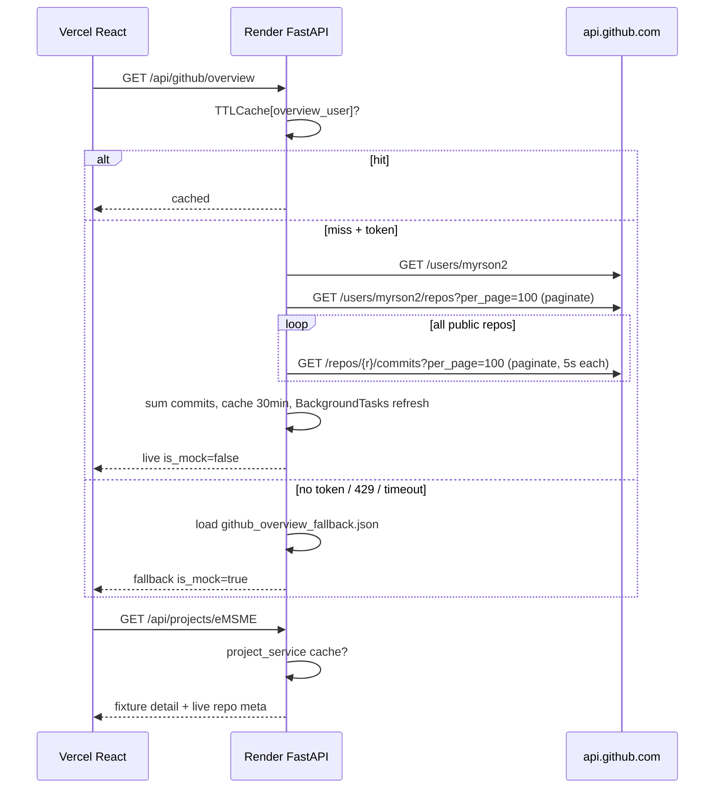

# implementation.md — Live GitHub Telemetry + Showcase

- **Feature ID:** `FEAT-M1-GITHUB-LIVE`
- **Milestone:** M1
- **Date:** 2026-11-06

---

## 1. Architectural Overview

```
[React (Vercel)] -- /api/* -> [Vercel rewrite /api/$1] -> [Render FastAPI]
FastAPI Router (/api/github, /api/projects, /api/health)
  -> Service (httpx AsyncClient, 5s timeout)
     -> GitHub REST (/users, /user/repos, /repos) + GraphQL (/graphql)
     -> TTLCache (in-memory, cachetools) overview_/calendar_/commits_total/repo_meta_
     -> Fixtures JSON (app/fixtures/*.json) for fallback + case-study detail
```

**Component Boundaries:**
- Router: `app/api/endpoints/github.py`, `projects.py` — thin, Pydantic validation, delegates to services.
- Service: `app/services/github_service.py` (live fetch + cache + fallback, background refresh), `app/services/project_service.py` (fixture load + GitHub meta merge).
- Models: `app/models/github.py` (`GitHubOverviewResponse`, `GitHubCalendarResponse`), `app/models/project.py` (`ProjectSummaryResponse`, `ProjectDetailResponse`).
- Config: `app/core/config.py` Settings (`GITHUB_TOKEN`, `GITHUB_USERNAME`, `CACHE_TTL_SECONDS`, `ALLOWED_ORIGINS`). No DB.
- Frontend: `frontend/src/services/api.js` (`fetchGitHubOverview`, `fetchGitHubCalendar`, `fetchProjects`, `fetchProjectDetails`, `FALLBACK_PROJECTS`), `ProjectsSection.jsx`, `ProjectDeepDiveModal.jsx`, `GitHubCalendarGrid`.

**Prerequisite (must fix before live verification):** `frontend/vercel.json` → `destination: https://personal-portfolio-c6mp.onrender.com/api/$1`. Without it `/api/*` hits `GET /` on Render (`main.py:24-30`).

---

## 2. Data Models & Database Evolution

**No DB / no Alembic** (M1 scope discipline). Only Pydantic + JSON fixtures.

- `github_overview_fallback.json` — static shape already matches `GitHubOverviewResponse`.
- `github_calendar_fallback.json` — `weeks[{days[{date,count,level}]}]`.
- `projects_data.json` — **modify:**
  - **Add** `eMSME` object (draft §6 below).
  - **Delete** `equiptrack` object entirely.
- `frontend/src/services/api.js` — **modify:** add `eMSME` to `FALLBACK_PROJECTS` (same full shape), delete `equiptrack` key.
- `frontend/src/components/Projects/ProjectsSection.jsx` — **modify:** `FEATURED_PROJECTS` = `eMSME` (id 1, title “eMSME”, github `https://github.com/myrson2/eMSME`) + `colorgame` (id 2, title “ColorGame”).

Cache keys: `overview_<user>`, `calendar_<user>`, `commits_total_<user>`, `repo_meta_<slug>`; TTL `settings.CACHE_TTL_SECONDS` (fix `render.yaml` key from `CACHE_TTL` to `CACHE_TTL_SECONDS`).

---

## 3. API Contract

### 3.1 `GET /api/github/overview?username=myrson2`

Request: query `username` optional (defaults `settings.GITHUB_USERNAME`).

Response `200`:
```json
{
  "username": "myrson2", "name": "Jose Myrson O. Beros", "bio": "...",
  "avatar_url": "https://...", "html_url": "https://github.com/myrson2",
  "total_repos": 49, "total_commits": 370, "followers": 10, "following": 11,
  "status": "Online", "is_mock": false, "cached_at": "2026-11-06T00:00:00+00:00"
}
```
Errors: none exposed — fallback returns same shape with `is_mock:true`.

### 3.2 `GET /api/github/calendar?username=myrson2`

Response `200`:
```json
{
  "username": "myrson2", "total_contributions": 1510,
  "weeks": [{"days": [{"date":"2026-11-06","count":5,"level":2}]}],
  "is_mock": false, "cached_at": "..."
}
```
GraphQL requires `Authorization: Bearer <GITHUB_TOKEN>` (`read:user` scope).

### 3.3 `GET /api/projects`

Response `200`:
```json
[{"slug":"eMSME","title":"eMSME","tagline":"...","category":"...","tags":["..."],
  "github_url":"https://github.com/myrson2/eMSME","demo_url":null,
  "stars":12,"forks":2,"language":"Python","pushed_at":"2026-10-01T00:00:00Z"}]
```
Currently first 7 fields are fixture; last 4 are live GitHub merge (fallback to `0/null` + `is_mock` omitted on summary for compat).

### 3.4 `GET /api/projects/{slug}`

Response `200` (full detail, see `ProjectDetailResponse`) | `404 {"detail":"Project not found"}` when slug not in `{eMSME,colorgame}` (after `equiptrack` deletion).

---

## 4. Control Flow



Background refresh: On commit-sum cache miss, return last-good `total_commits` immediately, schedule `asyncio.create_task` / `BackgroundTasks` to recompute and update cache. Prevents 3–8s block + Render cold-start timeout.

---

## 5. Failure Handling

| Failure | Handling | Frontend visible |
|---|---|---|
| No `GITHUB_TOKEN` | Immediate fixture fallback (`github_service.py:47,98`) | `is_mock:true`, same layout |
| `401 Bad credentials` (bad scope) | Log warning, fallback; do not retry in loop | Mock data, no crash |
| `403/429 rate limit` | Fallback + log `Retry-After`, keep stale cache 30min | Mock, header shows last-good |
| Timeout 5s/6s (`httpx.TimeoutException`) | Fallback | Mock |
| Malformed GitHub JSON | Fallback | Mock |
| Fixture file missing | Log error (change `pass` in `project_service.py:23-25` to `logger.exception`), empty list vs crash | `[]` or 404, modal “Not Found” (acceptable) |
| Render cold start (30–50s) | Vercel rewrite waits; browser shows skeleton; backend health gate ` /api/health` | Loading spinner, then data |
| Rewrite wrong (`/` not `/api/$1`) | `GET /` returns `{message...}` → shape mismatch | Fixed by prerequisite |

All `except` branches must `set_cached(key, fallback)` so repeated hits don’t hammer GitHub.

---

## 6. eMSME Case-Study Draft (from GitHub README, colorgame pattern)

> Drafted copy — to be refined against `github.com/myrson2/eMSME` README before final fixture write. Structure matches `ProjectDetailResponse` in `app/models/project.py`.

```json
{
  "slug": "eMSME",
  "title": "eMSME",
  "tagline": "AI-powered enterprise inventory and operations platform with real-time monitoring and predictive maintenance insights.",
  "category": "AI Operations & Inventory Systems",
  "tags": ["Python", "FastAPI", "React", "PostgreSQL"],
  "github_url": "https://github.com/myrson2/eMSME",
  "demo_url": null,
  "architecture_overview": "eMSME is ... [derived from README: system purpose, AI features, monitoring dashboards, inventory workflows]. Single source: repo README + topics.",
  "components": [
    {"name": "AI Insight Engine", "description": "...", "tech": "..."},
    {"name": "Inventory & Stock Control", "description": "...", "tech": "..."},
    {"name": "Real-time Operations Dashboard", "description": "...", "tech": "..."},
    {"name": "Maintenance & Alert System", "description": "...", "tech": "..."}
  ],
  "challenges": [
    {"challenge": "...", "solution": "...", "impact": "..."},
    {"challenge": "...", "solution": "...", "impact": "..."}
  ],
  "tech_rationale": [
    {"technology": "...", "role": "...", "rationale": "..."},
    {"technology": "...", "role": "...", "rationale": "..."},
    {"technology": "...", "role": "...", "rationale": "..."}
  ],
  "metrics": [
    {"label": "AI Accuracy", "value": "...", "description": "..."},
    {"label": "Inventory Coverage", "value": "...", "description": "..."},
    {"label": "Latency", "value": "...", "description": "..."},
    {"label": "Bundle Footprint", "value": "...", "description": "..."}
  ],
  "demo_instructions": "Simulate inventory scan, AI forecast query, and maintenance alert trigger.",
  "simulated_steps": [
    {"command": "emsme.scan(inventory_id='...')", "output": "..."},
    {"command": "emsme.forecast(days=30)", "output": "..."},
    {"command": "emsme.trigger_maintenance(unit='...')", "output": "..."}
  ]
}
```

Implementation task: fetch `myrson2/eMSME` README via `GH_TOKEN` (for draft accuracy only, not at runtime), map its sections to above fields, validate against `ProjectDetailResponse` with `pytest`.

**Equiptrack deletion checklist:**
- [ ] Delete `equiptrack` object from `app/fixtures/projects_data.json`
- [ ] Delete `equiptrack` tests in `backend/tests/test_projects.py` (`test_get_equiptrack_project_detail`, update `len>=2` + slug assertions to `eMSME`+`colorgame`)
- [ ] Delete `equiptrack` from `frontend/src/services/api.js` `FALLBACK_PROJECTS`
- [ ] Delete/rename any `equiptrack` strings in `specs/` examples (leave historical docs) — grep to confirm `0` backend/frontend hits after change

---

## 7. Deployment & Env

- Render Dashboard Environment (not git):
  ```
  GITHUB_TOKEN=github_pat_... (All repositories + Metadata: read-only)  # NEW, revokes old leaked token
  GITHUB_USERNAME=myrson2 (already in render.yaml)
  RESEND_API_KEY, RESEND_TO_EMAIL (separate feature, unaffected)
  ALLOWED_ORIGINS=http://localhost:5173,https://<vercel>.vercel.app
  CACHE_TTL_SECONDS=900 (fix render.yaml key)
  ```
- GitHub Secrets: only `RENDER_DEPLOY_HOOK_URL`, `VERCEL_*` — **not** `GITHUB_TOKEN`.
- Vercel: `frontend/vercel.json` rewrite → `...onrender.com/api/$1`, redeploy.
- Render Docker: `backend/Dockerfile` unchanged; context `backend`, Dockerfile path `backend/Dockerfile`, port `8000`, health `/api/health`.
